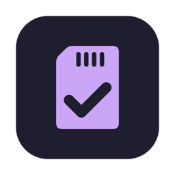
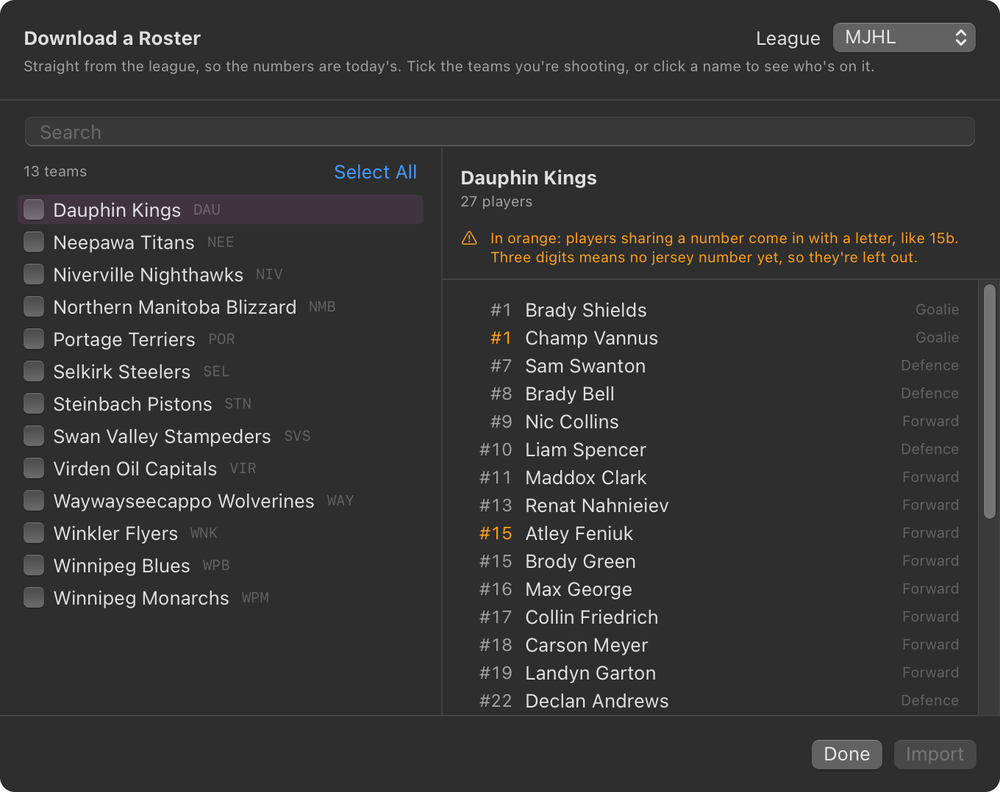
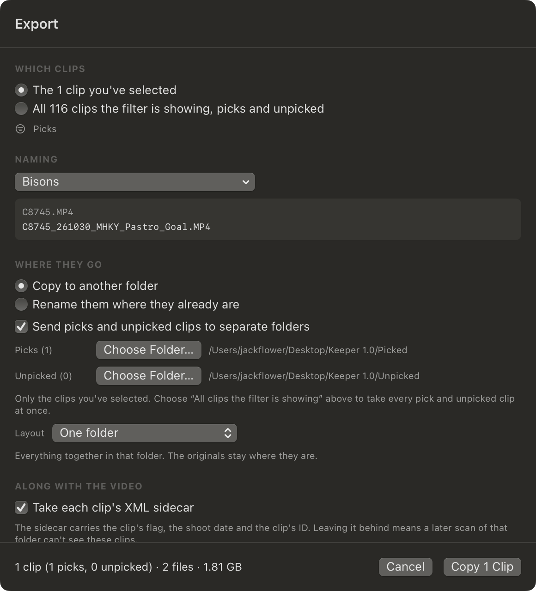
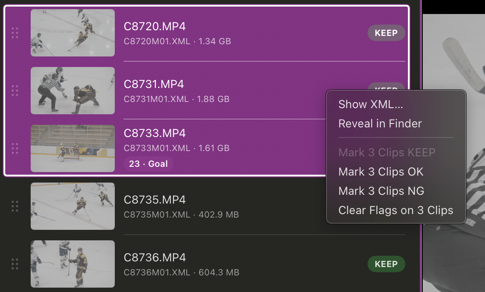
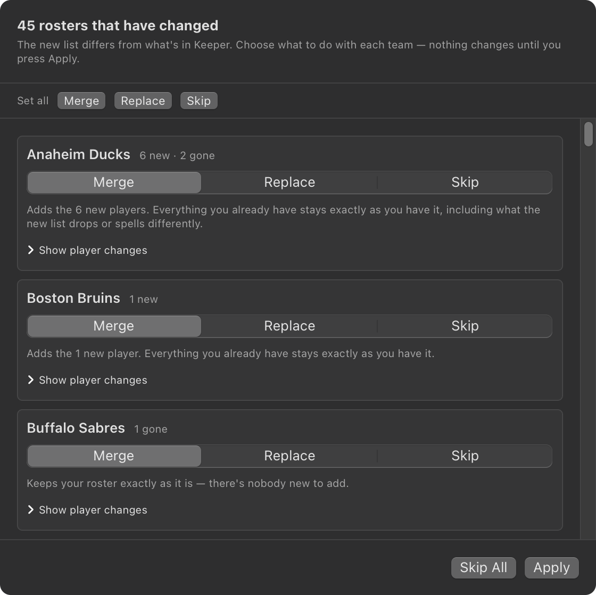
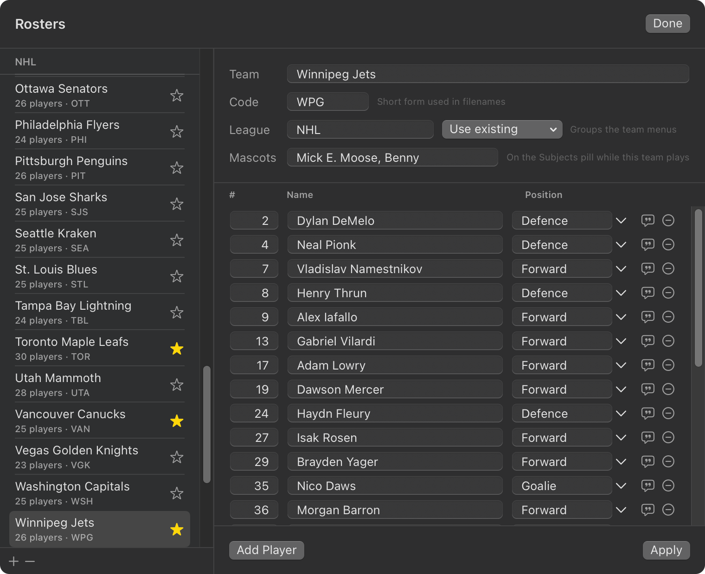
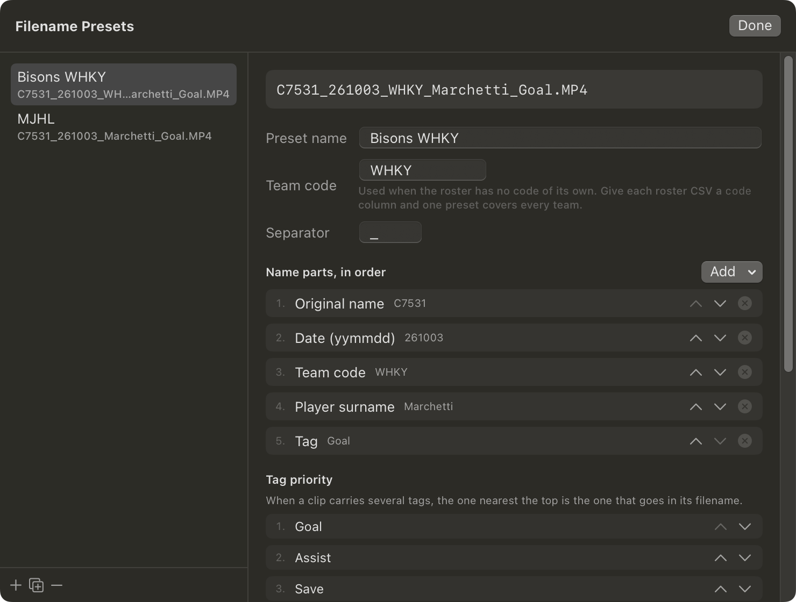

<div align="center">



# Keeper guide

A shoot day in six steps. **Help → Welcome & Tutorial** walks through the same six in the app.

[Camera](#1-set-up-the-camera) &nbsp;·&nbsp; [Roster](#2-get-your-roster) &nbsp;·&nbsp; [Card](#3-open-the-card) &nbsp;·&nbsp; [Tag](#4-tag) &nbsp;·&nbsp; [Export](#5-export) &nbsp;·&nbsp; [Check](#6-check-then-format) &nbsp;·&nbsp; [Reference](#reference)

</div>

## 1. Set up the camera

On a Sony, assign **Clip Flag** to custom buttons under **Custom Key Setting**: KEEP on one, and OK on another if you want it. Press while recording or playing back, and again to take it off.

| Flag | Use it for |
|:--|:--|
| **KEEP** | The best |
| **OK** | The rest worth keeping |

[Sony's Clip Flag guide](https://helpguide.sony.net/ilc/2210/v1/en/contents/TP1001690663.html) has the details. The FX3 needs firmware 6.00 or later.

> [!IMPORTANT]
> The flag is saved in the XML file beside each clip, so keep those files when you offload.

## 2. Get your roster

**File → Download a Roster…**, pick a league, tick your teams, **Import**.

| Level | Leagues |
|:--|:--|
| **Professional** | NHL, AHL, ECHL, PWHL |
| **Major Junior** | WHL, OHL, QMJHL |
| **Junior A** | MJHL, SJHL, AJHL, BCHL |

Any other league or sport: <kbd>⌘I</kbd> imports a CSV with a number and a name per player, or type one in with <kbd>⇧⌘R</kbd>.

<p align="center"></p>

## 3. Open the card

<kbd>⌘O</kbd> opens a card, drive or folder. You start on **Picks**, your KEEP and OK clips; **Unpicked** has the rest.

| Key | What it does |
|:--|:--|
| <kbd>↑</kbd> <kbd>↓</kbd> | Move between clips |
| <kbd>Space</kbd> | Play |
| <kbd>⌘Return</kbd> | Mark KEEP, or unpick |
| <kbd>O</kbd> | Mark OK |
| <kbd>⌘Z</kbd> | Undo |

The card isn't touched. A flag you change goes on the copy.

## 4. Tag

Pick your team in the panel under the video, and tick **Both teams** for a game. Click a player, then what happened.

Faster: turn on keyboard tagging with <kbd>⇧⌘T</kbd>.

| Type | To |
|:--|:--|
| <kbd>↓</kbd> | pick the clip |
| <kbd>Return</kbd> | go to the roster |
| <kbd>1</kbd> <kbd>7</kbd> | find the jersey number (or type a name) |
| <kbd>Return</kbd> | go to the categories |
| <kbd>g</kbd> <kbd>o</kbd> | find Goal (or type its number) |
| <kbd>Return</kbd> | tag it and move to the next clip |

<kbd>⇧Return</kbd> tags and stays on the clip, for a second player. The mascot, the crowd and the anthem are on the **Subjects** pill.

## 5. Export

<kbd>⌘S</kbd>. Pick a filename preset and a folder, and your picks are copied out, named from their tags. Run it again and anything already copied is skipped.

<p align="center"></p>

## 6. Check, then format

**Check Copied** (<kbd>⇧⌘V</kbd>) compares your copies with the card and lists anything missing or the wrong size. Add every folder you copied to.

> [!WARNING]
> Only format the card once it's clean.

---

# Reference

Everything else, to look up when you need it. Click a heading to open it.

<details>
<summary><b>Shortcuts</b></summary>

**Watching**

| Key | What it does |
|:--|:--|
| <kbd>↑</kbd> <kbd>↓</kbd> | Previous, next clip |
| <kbd>Space</kbd> or <kbd>2</kbd> | Play, pause |
| <kbd>1</kbd> <kbd>3</kbd> | Shuttle back, forward (again for 2x, 4x, 8x) |
| <kbd>⌘F</kbd> | Full screen (<kbd>Esc</kbd> to exit) |

**Flags**

| Key | What it does |
|:--|:--|
| <kbd>⌘Return</kbd> | KEEP the previewed clip, or unpick it |
| <kbd>O</kbd> | OK on or off |
| <kbd>⇧⌘Return</kbd> | KEEP the selection |
| <kbd>⌥⌘Return</kbd> | Clear flags on the selection |
| <kbd>⌘Z</kbd> <kbd>⇧⌘Z</kbd> | Undo, redo |

**Files and rosters**

| Key | What it does |
|:--|:--|
| <kbd>⌘O</kbd> | Choose folder |
| <kbd>⌘R</kbd> | Rescan |
| <kbd>⌘I</kbd> | Import roster CSV |
| <kbd>⇧⌘R</kbd> | Edit rosters |
| <kbd>⌘S</kbd> | Export |
| <kbd>⇧⌘V</kbd> | Check copied |
| <kbd>⌘D</kbd> | Debug log |
| <kbd>⌘,</kbd> | Change any shortcut |

**Tagging and games**

| Key | What it does |
|:--|:--|
| <kbd>⌘E</kbd> | Tagging panel |
| <kbd>⇧⌘T</kbd> | Keyboard tagging |
| <kbd>T</kbd> | Tag with no player, with keyboard tagging on |
| <kbd>§</kbd> | Subjects pill, at the bench |
| <kbd>/</kbd> | Clear tags on selected clips |
| <kbd>⌘0</kbd>, <kbd>⌘1</kbd> to <kbd>⌘9</kbd> | All games, or one of them |
| <kbd>⌘]</kbd> | Next game |

</details>

<details>
<summary><b>Clips and flags</b></summary>

Badges show each clip's flag: **KEEP** green, **OK** yellow, **NG** red, **—** none. An orange outline means you changed it.

- Click the badge to toggle KEEP, or right-click for KEEP, OK, NG, Clear or Revert.
- <kbd>⌘Return</kbd> and O move to the next clip after marking. Turn that off in **Mark → Move On After Marking**.
- With several clips selected, they mark all of them the way the previewed clip goes, and stay put. The right-click and **Mark** menus change the selection too.
- The menus above the list filter by team, player, position, category and subject.

<p align="center"></p>

</details>

<details>
<summary><b>Rosters</b></summary>

**CSV files.** Only `number` and `name` are required:

```csv
league,team,code,number,name,position,mascots
MJHL,Virden Oil Capitals,VIR,27,Liam Goertzen,Forward,
```

- `code` is the short team name used in filenames.
- `league` groups teams in the menus.
- `mascots` are separated by semicolons. Any row can carry them.
- Without a `team` column, the filename is the team name.

**Teams you already have** are held for you to choose, with every change shown first:

- **Merge** keeps yours and adds new players. It doesn't remove anyone.
- **Replace** uses the new list, and removes players who aren't on it. A new name on a number is a new player; tick **Same player** under **Show player changes** for a corrected spelling.
- **Skip** leaves the team alone.

**Keeping up to date.** **File → Update All Rosters…** checks every team you have from a league Keeper can download, with **Set all** at the top. A backup is saved first. An orange icon beside a team in play means its league has changed the list; Keeper asks once a day, and nothing changes until you click it and choose.

<p align="center"></p>

The lists come from the leagues' websites and aren't an official service, so a league can stop working without notice. Rosters you have aren't affected.

**Two players in one number.** A regular keeps the number and a call-up gets a letter: **15** and **15b**. If it isn't clear whose it is, they're **15a** and **15b**. Typing 15 shows everyone in it, later downloads keep the letter, and filenames leave it out. Three-digit numbers mean no jersey number yet, so those players are left out.

**Editing (<kbd>⇧⌘R</kbd>).** Numbers must be unique within a team. Changing one leaves old clips on the number worn in them, unless you tick **Change old tags too**. Editing a name on its row carries that player's clips to the new name.

<p align="center"></p>

- **Favourites**: click a team's star and it's at the top of every team menu. Past 20 teams, the menus fold into leagues.
- **Mascots**: a team's own join the Subjects pill while it's in play. NHL downloads include them.
- **Nicknames**: the speech bubble on a player's row. Filenames use it in place of the surname. **Replace** keeps it only while the name and number both match.

**Old clips** keep the name, number, position and team they were tagged with. Someone who changes number keeps their old clips; someone who leaves stays named on theirs, marked **Not on roster**. Imports and updates never change a tag, except a name you tick as **Same player** or a position it didn't have.

</details>

<details>
<summary><b>Tagging</b></summary>

- <kbd>⌘E</kbd> shows or hides the panel. Turn off **View → Tagging Panel Below Video** to put it beside the video.
- **Both teams** puts two rosters from the same league in play; ← → switch between them.
- Categories are in sections. **+** adds one; right-click to move or remove.
- **+** by the categories adds a one-off tag. They collect under **Recent**, and one with 10 or more tags moves to **Most Used**. Right-click to keep it or forget it.
- A tag shows as `17 · Goal`, or `Mascot · Goal` for a subject. Hover for the full name and team.
- **Move On After Tagging** (View menu) goes to the next clip after each tag.

**With keyboard tagging on:**

- <kbd>Tab</kbd> / <kbd>⇧Tab</kbd> move between clips, roster and categories. <kbd>Escape</kbd> clears what you've typed, then goes back a step.
- At the roster, letters search names on the team showing and the subjects. Any word of the name works.
- At the categories, type a word or a category's number, then Return. ← → change section, and the numbers change with it. Typing searches every section.
- If no category matches, Return tags the clip with your word. If one does, ↓ reaches your exact word at the end of the list. Space types a space while you do.
- <kbd>T</kbd> at the clip step goes straight to the categories, for a tag with no player.
- <kbd>O</kbd> marks OK at the clip step only.

</details>

<details>
<summary><b>Two games on one card</b></summary>

Right-click the first clip of the second game and choose **New Game Starts Here**. Each game gets a tab, named from its teams, and remembers its own rosters. <kbd>⌘1</kbd> to <kbd>⌘9</kbd> go to a game, <kbd>⌘0</kbd> to All, and <kbd>⌘]</kbd> steps through them.

- A clip in the wrong game: right-click, **Move to Game**.
- **Remove This Game** on a tab puts its clips in the game beside it. Tags aren't touched.
- The split is saved with your library, not on the card. New clips shot within 12 hours join the game beside them.
- Clips in no game go under **No Game**, so they can't be missed.
- Exporting from a tab copies that game. From **All**, **Put each game in its own folder** does every game in one run.

</details>

<details>
<summary><b>Exporting and filenames</b></summary>

- **Which clips**: the selection, or everything shown.
- **Naming**: a filename preset, or the camera's names.
- **Where**: copy to a folder, or rename in place (not allowed on a card).
- **Layout**: one folder, per category, or per player.
- **Split**: picks to one folder, unpicked to another.
- **Sidecar**: whether the XML goes too. It's needed to carry flag changes.

**Edit Presets…** builds names from parts: original name, shoot date, team code, surname, category. One preset per client.

<p align="center"></p>

</details>

<details>
<summary><b>Settings</b></summary>

| Setting | Where | Default |
|---|---|---|
| Camera | Toolbar | Sony |
| Move On After Marking | Mark menu | On |
| Move On After Tagging | View menu | Off |
| Tagging Panel Below Video | View menu | On |
| Theme | View menu | System |
| Accent | View menu | Mauve |
| Warn Before Clearing Tags | View menu | On |
| Hold for Subjects Only | View menu | Off |
| Include XML Sidecars | View menu | On |
| Keep the Mac Awake While Transferring | View menu | On |
| Check for Updates Automatically | Help menu | On |
| Check Rosters for Changes | Help menu | On |

**Theme** recolours Keeper with one of [Catppuccin](https://catppuccin.com/palette/)'s four flavours: Latte (light), Frappé, Macchiato or Mocha. **Accent** picks one of its fourteen accent colours for highlights; it's greyed under System, which uses the accent from System Settings. Native controls such as dropdowns, checkboxes and menus follow the theme's light or dark but keep the macOS look.

</details>

<details>
<summary><b>Troubleshooting and known gaps</b></summary>

- **Other cameras**: built and tested on a Sony A7S III. For anything else, choose **Other…** in the **Camera** menu and type the word your camera writes.
- **No clips flagged?** Right-click a clip → **Show XML…** to see that word.
- **Clip not listed?** A clip needs its XML sidecar. Proxy files in `SUB` folders aren't handled.
- **Debug log** (<kbd>⌘D</kbd>) shows how each clip was read and every copy result.
- **Undo a roster change**: **File → Restore Tags** rolls back to a backup, tags included.
- Your library is at `~/Library/Application Support/Keeper/library.json`.

Keeper uses the network for two things: checking GitHub once a day for a new version, and rosters (downloading one, and asking once a day whether the ones in play have changed). Nothing installs itself. Turn either check off in the **Help** menu.

</details>

---

<div align="center">

[Back to Keeper](README.md) &nbsp;·&nbsp; [Report a problem](../../issues)

</div>
