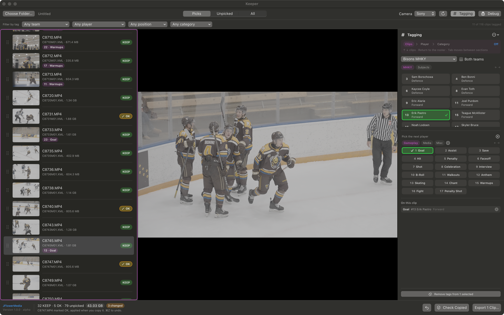
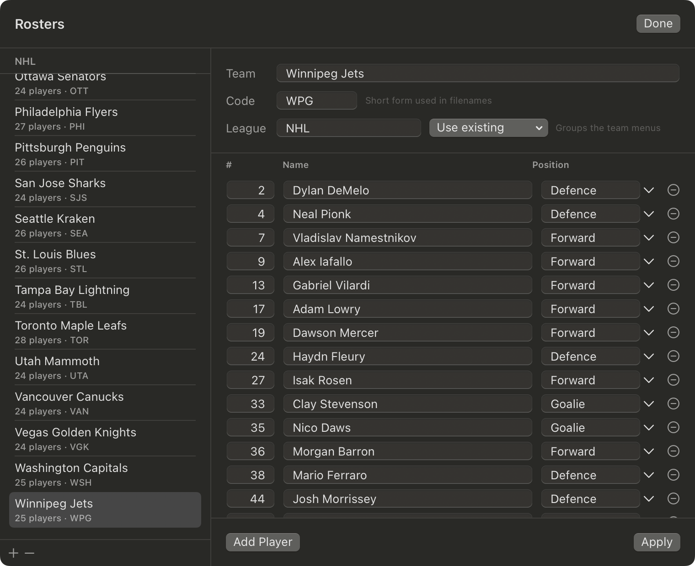
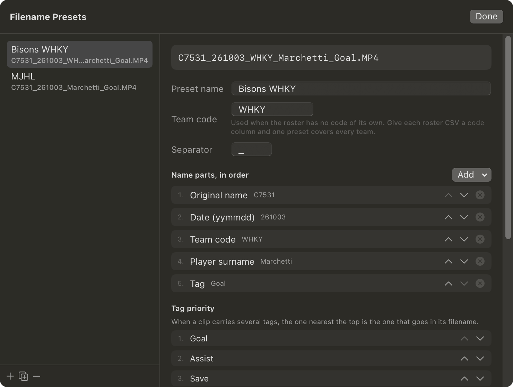

# Keeper

A macOS app for getting sports footage off a card and into a delivery. It reads the KEEP flag your camera writes into its XML sidecars, lets you tag clips to players and events, and copies them out renamed and sorted.

Built by [JFlowerMedia](https://jflowermedia.com/) · [Download](../../releases) · macOS 13 or later

> **Alpha, version 0.9.2.** Tested against one camera on one Mac. It never writes to your cards, but don't let it be the only copy of footage you care about. Bug reports welcome in [Issues](../../issues).



## What it does

**Reads the flag you set in camera.** Point it at a card, an SSD, or any folder of footage. It finds the XML sidecars, pairs each to its video, and filters to the clips you marked KEEP — or the ones you didn't, for warmups and B-roll. You can mark and unmark clips in the app too; those changes go into the exported sidecar, never onto the card.

**Previews without leaving the app.** Space plays and pauses, 1 and 3 shuttle back and forward through 2x, 4x and 8x, and the arrow keys walk the list — so a review pass never needs the mouse. ⌘F fills the screen. Every one of those keys can be changed.

**Tags clips to players and events.** Download a roster, import one as a CSV, or type one in. Click a player, then a category — Goal, Save, Hit, or your own. Turn on **Both teams** for a game and switch benches with one key. Several players can be tagged on one clip with different categories, so one gets the goal and another the assist.

**Or tag without the mouse.** Turn on keyboard tagging and a clip is arrow, Tab, jersey number, Return, Return — through the clips, into the roster, onto the category and on to the next clip.



**Filters by what you tagged.** Team, player, position and category, in any combination, on top of the KEEP filter. Every save by a goalie, or every clip of #17 you marked KEEP, is a few clicks.

**Renames to a client's convention.** Build a preset from the parts you want — original name, shoot date, team code, player surname, event — and keep one per client.

```
C7531_261003_WHKY_Marchetti_Goal.MP4
```



**Checks the card copied before you format it.** Point it at the folders you copied to — however many — and it accounts for every clip on the card. It matches on the camera's clip ID rather than the filename, so it still works after you've renamed everything, which no general file-compare tool can do.

**Exports in one sheet.** It shows which clips are included, the names it will produce, where they're going and how much data that is, before anything moves. Copy them out into one folder, a folder per player, or a folder per event — or rename footage you already offloaded where it sits, so you don't end up holding the same game twice. Clips can also be dragged straight into Finder.


## Copy safety

- Keeper never writes to, renames or deletes anything on a camera card. A flag you changed is applied to the copy; the card keeps what you set in camera.
- Free space at the destination is checked before anything is written.
- Every copy is size-checked against its source afterwards. A mismatch is reported as a failure, not a success.
- A file already there with the same name and size is skipped as a duplicate.
- A clip's video and sidecar are named together, so a filename clash can't separate them.
- Tags are keyed to the camera's UMID rather than the filename, so they survive renaming, copying to another drive, and a card restarting its numbering.
- A copy that fails five times in a row stops, rather than filling the log with the same error for every remaining file.
- The Mac is held awake while footage is copying or being checked, so it can't idle to sleep halfway through. This holds off *idle* sleep only — closing a laptop lid, choosing Sleep, or a flat battery will still sleep the machine mid-copy, so leave the lid open for a long offload. On by default; **View → Keep the Mac Awake While Transferring** turns it off, and that takes effect immediately even mid-copy. Nothing about it outlives the app — quitting Keeper releases the hold either way.
- Your tags are backed up automatically, ten versions deep, and any of them can be restored.
- ⌘Z takes back a flag change or a tag, forty steps deep — including a bulk mark or a bulk tag removal, in one press.

## Which cameras

**Set the flag up in camera first.** Keeper sorts by the KEEP flag, so the camera has to be putting one on. On a Sony, assign **Clip Flag KEEP** to a custom button (**Custom Key Setting**), then press it while recording or playing a clip back; press it twice to take it off. [Sony's guide to Clip Flag](https://helpguide.sony.net/ilc/2210/v1/en/contents/TP1001690663.html) has the details — it's written for the FX3, where Clip Flag needs firmware 6.00 or later, so check your own body's firmware.

**Keep the XML files.** The flag is saved in the XML sidecar the camera writes beside each clip, not in the video. Point Keeper at the card itself, or at a copy that kept those files — an offload that copied only the `.MP4`s leaves nothing to read, and those clips won't be listed.

Built against a **Sony ILCE-7SM3 (A7S III)**, where a flagged clip's XML carries `status="KEEP"` on `<TargetMaterial>`. Sony is the only camera in the **Camera** menu because it's the only one tested. **Other…** takes whatever word your camera writes, and detection is deliberately loose, so other cameras that write an XML sidecar are likely to work. If yours doesn't, debug mode shows what's in your sidecars — open an issue with it.

## Install

Download `Keeper.zip` from [Releases](../../releases), unzip, and drag **Keeper.app** to Applications.

### macOS will block it on first launch

You'll see *"Apple could not verify Keeper is free of malware."* Keeper isn't notarized by Apple, which needs a paid developer account. The app is open source: every line is in this repo, and you can build it yourself rather than take my word for it.

1. Double-click Keeper, then click **Done** on the warning.
2. Open **System Settings → Privacy & Security**, scroll to **Security**, and click **Open Anyway** beside the line about Keeper.
3. Authenticate, open Keeper again, click **Open**.

Once per version. Or skip it in one command:

```
xattr -dr com.apple.quarantine /Applications/Keeper.app
```

### Build from source instead

Needs macOS 13+ and Xcode's command line tools (`xcode-select --install`).

```
git clone https://github.com/jflowermedia/keeper.git
cd keeper
chmod +x build_app.sh
./build_app.sh --install
```

[DEVELOPING.md](DEVELOPING.md) has the rest.

---

# Guide

On a first launch Keeper offers a short walkthrough of the basics: setting up the flag in camera, then card, KEEPs, roster, tags, export, check. **Help → Welcome & Tutorial** brings it back at any point, and the keys it quotes follow your own shortcuts rather than the defaults. Its last step links here, and so does **Help → Keeper Guide**. This is the long version, with every setting.

## Shortcuts

| | |
|---|---|
| ↑ and ↓ | Previous and next clip |
| Space or 2 | Play, pause |
| 1 and 3 | Shuttle back and forward — press again for 2x, 4x, 8x |
| ⌘F | Full screen preview (Escape to come back) |
| ⌘K | Toggle KEEP on the previewed clip |
| ⌘⇧K | Mark the selection KEEP |
| ⌥⌘K | Mark the selection NOT KEEP |
| ⌘Z | Undo the last flag or tag change |
| ⌘⇧Z | Redo |
| ⌘O | Choose folder |
| ⌘R | Rescan |
| ⌘E | Tagging panel |
| ⌘⇧T | Keyboard tagging |
| ⌘I | Import roster CSV |
| ⌘⇧R | Edit rosters |
| ⌘S | Export |
| ⌘⇧V | Check the card copied |
| ⌘D | Debug log |
| / | Clear the tags on the selected clips |
| § | At the bench, switch to the Subjects pill and back (see Rosters) |
| ⌘, | Keyboard Shortcuts — change any of these |

**⌘,** opens **Keyboard Shortcuts…**. Click a key, press the one you want. The review keys — play, shuttle, previous and next — are single presses with no modifier so they work one-handed; the menu commands need ⌘. Take a key that's already in use and the two swap, so nothing is ever left without one. **Reset All** puts them back.

## Scanning

**Choose Folder…** takes a card, an SSD, or any folder, and scans everything underneath for `.xml` sidecars. Filter by **Kept**, **Not kept** or **All**. Click a clip to preview it, shift or ⌘-click for several, ⌘A for all.

The footer counts the clips and totals the data the filter is showing, so **Kept** answers "how much am I actually keeping" and **All** answers "how big is this card". Hover the figure for all three at once.

Once a clip is playing, ↑ and ↓ move through the list and the preview follows, so a pass is arrow, space, ⌘K, arrow — no mouse. The arrows work full screen too.

## Changing a flag

Click a clip's **KEEP** badge, or ⌘K for the one in the viewer. ⌘K then moves to the next clip, so a pass down a card is watch, mark, watch, mark — turn that off with **Mark → Move On After Marking**. A badge click never moves the preview, whichever way that's set.

The **Mark** menu does a whole selection at once. Changed clips get an orange badge; right-click to put it back.

Wrong clip? **⌘Z**, or the undo button at the bottom right. It names what it's about to undo, so you can check before you press it.

Nothing is written to your card. The change is applied to the sidecar on export, and only if the sidecar goes with it — the export sheet says so when it won't.

## Rosters

Import a CSV with ⌘I. `roster-yateley-wood-pigeons.csv` is in this repo to test with.

```csv
league,team,code,number,name,position
MJHL,Virden Oil Capitals,VIR,27,Liam Goertzen,Forward
MJHL,Virden Oil Capitals,VIR,31,Micky Gross,Goalie
```

Only `number` and `name` are needed. A header row is optional, several teams can share a file, and without a `team` column the filename becomes the team.

- **`code`** is the short form used in filenames.
- **`league`** groups the team menus. `org`, `organisation`, `organization` and `group` work too.

Team names must be distinct, since an import matches teams by name — a club's men's and women's sides need names that differ.

**Importing a team you already have** — from a CSV or a download — shows what would change before anything is written: who's new, who's gone, and whose name or position differs. For each team pick **Merge**, which adds the new players and keeps everyone you have exactly as you have them, so a spelling you fixed by hand survives; **Replace**, which uses the new list exactly; or **Skip**. Merge is the default. A team that comes in identical, or one you don't have yet, imports without asking. Existing tags pick up corrected names, matched on team and number, and columns you leave out keep what's already set.

**Categories come in sections** — Gameplay, Media, Misc to start. **← →** step between them and **↑ ↓** move within one, the same way ← → switch benches a stage earlier. Click **+** beside the pills to add a section; right-click a pill to move or remove it. Right-click a category and **Move “Anthem” to** files it under another section, which is how a list built before sections gets sorted out — an existing library arrives with everything in Gameplay. Removing a section takes its categories with it, but clips already tagged keep their labels. A new category joins whichever section you're looking at.

**Type a number to reach a category.** In keyboard tagging each category shows its position in the section, and typing that number narrows the grid the same way typing a shirt number narrows the bench — type `1` and press Return to tag the first one, `12` for the twelfth. **⌫** takes a digit back. The numbers are positions, not labels, so reordering a category or moving it to another section renumbers it straight away.

**One-off tags.** Click **+** by the categories, type a word and press **Tag**: the clip is tagged and the word is kept to hand as a one-off without joining your permanent list. One-offs gather in their own **Recent** section at the end, in italics, the last twelve are kept and the oldest falls off by itself, so a word you used once on one card doesn't silt up the list forever. Right-click one to **Keep** it permanently or **Forget** it. A real category always outranks a one-off in filenames, so a goal with dancing in it is still named for the goal. **Add** puts a word straight in the permanent list instead.

**§** at the bench jumps to the Subjects pill; press it again to go back to the team. That's the key left of 1 on a British keyboard — a US layout has ` there, so it's rebindable in **Keyboard Shortcuts** under *Keyboard tagging*. It works at the bench and nowhere else. Typing a number goes back to the team, since subjects have no number. By default it toggles; **View → Hold for Subjects Only** makes it a hold instead, so the subjects show while the key is down and the team comes back when you let go.

**To get a roster without typing it in**, use **File → Download a Roster…**. Pick a league at the top of the sheet — the NHL is the only one so far — and it asks that league's own public API who's playing. Click a team's name to see its players before you import; a number two players share is flagged there, since that team won't import. Tick the teams you want, or **Select All** for the whole league, and they import with today's numbers. A whole league takes a moment, and the sheet counts through it. It goes through exactly the same checks an imported CSV does, including refusing a team where two players share a number.

For any league not in the picker, **⌘I** imports a CSV — the format is above, and `tools/nhl-rosters.py` is a worked example if you want to script your own.

**Subjects** are the things you shoot that aren't on a roster — the mascot, the crowd, the anthem, the arena. They have a **Subjects** pill of their own, to the right of the team pills, and tag exactly like a player, so a mascot shot during a goal celebration can be the subject *Mascot* and the category *Celebration* rather than spending the category on saying who's in it. Click the pill, or press **← →** past the last team, to reach them. Add your own with **+ Subject** on that pill; right-click one to remove it. Typing a shirt number from the Subjects pill takes you back to the team, since subjects have no number. A subject's tag records whichever team pill you were last on.

**⌘⇧R** edits rosters in the app: names, numbers, positions, team code and league, adding and removing players and teams.

Two players can't share a number and two teams can't share a name, because that's how Keeper tells them apart. Renumbering a player carries their existing tags across; removing a player leaves their tags behind, so prefer renumbering.

## Tagging

⌘E for the panel. Click a player, then a category. The selection clears straight after, so one player gets the goal and the next gets the assist. Select several players first when they genuinely share a category.

An accent ring means **picked**. A green tick means **already on this clip**.

**Move On After Tagging**, in the panel's ⋯ menu and the View menu, goes to the next clip as soon as a tag lands. It's off by default, because a clip usually takes two tags — a goal for one player and an assist for another — and moving on after the first would put the second on the wrong clip. Turn it on for a pass where each clip gets one tag.

### Both teams at once

Tick **Both teams** beside the roster menu for a game. Off, picking a roster swaps it in. On, a second roster can join the first, up to two, and only from the same league: teams in another league are greyed out in the menu. Turning it off keeps whichever bench is on screen. Importing a team that's already in play leaves both benches as they are; importing a new one from the same league takes the place of the bench on screen. A tag takes the team from the player, so it doesn't matter which bench they're on.

Only one bench shows at a time — forty chips is too many to read at once. A row of pills shows each team's code, then **Subjects**; click one, or press **← →**, to switch. A typed jersey number only reaches the bench on screen, so 9 always means *this* team's #9.

### Keyboard tagging

**⌘⇧T**, or **Keyboard Tagging** in the View menu. A strip shows where the keyboard is — Clips, Player, Category — and what the next press does, and the section itself is outlined, so it's obvious at a glance where Tab has just put you.

**Tab** moves between the three sections and does nothing else. **Return** is what acts.

```
↓ ↓        move through the clips
Return     this is the clip — on to the roster
17         type the jersey number
Return     picks #17, straight to the categories
G          jumps to Goal
Return     tags it, and moves to the next clip
```

- **Type the number to narrow the roster.** 1 leaves #1 and #10–#19 on screen, 7 then leaves #17 on its own — so you're picking from what you can see rather than hunting a highlight. **⌫** goes back a digit, and a digit that would leave nobody is refused rather than blanking the grid. The filter clears itself the moment you leave the step.
- **First letter** jumps to a category. Press it again for the next match — S goes Save, then Shot.
- **⇧Return** tags it and stays on the clip, back at the players — that's the goal then the assist.
- **Tab** cycles clips → roster → categories → clips, **⇧Tab** the other way. Tabbing past the roster without picking anyone is fine — some tags have no player — and the strip then says it will tag the clip itself.
- **Escape** steps back a section. **Off** in the strip hands the keyboard back.

Space still plays and pauses throughout, and ⌘K still marks KEEP, because the flow only takes the keys it's using at the step it's on.

Categories start as Goal, Assist, Save, Hit, Penalty, Faceoff, Shot, Celebration, Interview and B-Roll. Add with **+**, remove by right-clicking. Their order decides which tag wins when a clip has several.

The bar under the toolbar filters by team, player, position and category, on top of the KEEP filter.

## Exporting

⌘S opens one sheet, which asks four things:

- **Which clips** — your selection, or everything the filter is showing
- **Naming** — a preset or the camera's names, with a before-and-after
- **Where they go** — copy to another folder, or rename them in place
- **Along with the video** — whether the sidecar travels, and what happens to changed flags

The button names what it's about to do, and the line beside it totals the files and the data.

**Layout**, when copying:

- *One folder* — everything together
- *Folder per category* — one copy of each clip, in its top tag's folder
- *Folder per player* — a copy in each tagged player's folder, so every player's folder is complete

**Rename them where they already are** is for footage you've offloaded already: it renames in place so you don't end up holding the same game twice. It's refused on a card, and it breaks the media links in any edit already built on those files.

Dragging to Finder keeps the camera names — macOS gives the app no say in what a dropped file is called. Whether the sidecar goes too is **View → Include XML Sidecars**, the same setting the sheet shows.

## Filenames

The built-in **Standard** preset gives `C7531_261003_YWP_Marchetti_Goal.MP4` — original name, shoot date, team code, player surname, tag. The date comes from the XML, so it's when the camera rolled.

Build your own in **Edit Presets…**: a name, a fallback team code, a separator, and the parts in order. Duplicate an existing preset for a new client rather than starting over. Empty parts drop out, so an untagged clip comes out `C7532_261003_YWP.MP4` rather than with gaps.

## Settings

Everything adjustable, and where it lives. None of it touches a card. Defaults are what you get on a fresh install.

| Setting | Where | Default | What it does |
|---|---|---|---|
| **Camera** | Toolbar | Sony | Which camera made the clips, so Keeper knows how it marks a kept one. **Other…** shows a box for the word your camera writes; press Return to rescan. |
| **Both teams** | Tagging panel, beside the roster menu | Off | Two rosters in play for a game, from the same league. |
| **Move On After Marking** | Mark menu | On | ⌘K goes to the next clip. A badge click never moves the preview either way. |
| **Move On After Tagging** | View menu, tagging panel ⋯ | Off | Goes to the next clip as soon as a tag lands. Leave it off if a clip usually takes two tags. |
| **Warn Before Clearing Tags** | View menu | On | Whether `/` and the Remove Tags button ask first. ⌘Z restores them either way. |
| **Hold for Subjects Only** | View menu | Off | Makes `§` a hold instead of a toggle: the Subjects pill shows while it's down. |
| **Include XML Sidecars** | View menu, Export sheet | On | Whether a clip's sidecar travels with it. This is the setting that applies when you drag a row to Finder. |
| **Keep the Mac Awake While Transferring** | View menu | On | Stops idle sleep during a copy or a check. Takes effect immediately, even mid-copy. |
| **Debug Log** | View menu, toolbar, ⌘D | Off | Shows which sidecar paired with which video and the result of every copy. |
| **Check for Updates Automatically** | Help menu | On | A once-a-day request to GitHub. Off means Keeper never checks. |
| **Keyboard Shortcuts…** | ⌘, | | Rebind any key above. |
| **Edit Filename Presets…** | File menu | | Build a naming convention per client. |
| **Restore Tags** | File menu | | Roll the library back to a backup. |

The Export sheet starts from its defaults each time you open Keeper — camera names, one folder, copying — so pick your preset and layout per session.

## If something's wrong

**Before formatting a card** — **Check Copied** at the bottom right, or ⌘⇧V. When a copy finishes, a link beside the status line opens it with that copy's folder already added. Add every folder you copied that card into, and it reports which clips are accounted for, which are missing, and which arrived the wrong size, with the gigabytes on the card set against the gigabytes found in each folder. Matching is by the camera's clip ID, so renamed copies are still recognised; that needs the XML sidecars to have travelled with them.

**No KEEP clips found** — right-click a clip, choose **Show XML…** to see what your camera writes, then pick **Other…** in the **Camera** menu and type that word in.

**A copy that keeps failing** stops itself after five failures in a row and says so, rather than reporting one identical error per remaining file. Check the destination has room and is still connected, then run it again — what already copied is kept and skipped as duplicates.

**⌘D** opens the debug log: which sidecar paired with which video, what marked each clip, and the result of every copy. **Copy Log** puts it on the clipboard for a bug report.

**Your tags live in** `~/Library/Application Support/Keeper/library.json`, with teams, categories and presets.

**To clear every tag from a set of clips**, select them and press **/** — or use the button at the bottom of the tagging panel. It only ever acts on clips you've selected: with nothing selected it refuses and says so, rather than falling back to everything on screen. ⌘Z puts them back, and the key is rebindable in **Keyboard Shortcuts**. The question has a **Don't ask again** box, and **View → Warn Before Clearing Tags** brings it back — it's on by default.

**To take back a flag or a tag**, **⌘Z** — the undo button at the bottom right does the same, and both name the change. It covers marking and unmarking, in bulk as well as one at a time, tagging, and removing tags. Forty steps deep, and ⌘⇧Z redoes. It doesn't survive quitting, and it deliberately doesn't cover roster edits or a restore — those are bigger than one keystroke and have the backups below.

**To undo a roster edit or a restore**, use **File → Restore Tags**. Keeper copies the library before writing to it, keeps the last ten versions in a `Backups` folder beside it, and lists them there by date. Restoring backs up what you have first, so it can be undone the same way. Nothing on your cards or drives is touched either way.

---

## Updates

Keeper asks GitHub once a day whether there's a newer release, and shows a strip along the bottom of the window if there is. **What's New** opens the release page; **Skip This One** stops it mentioning that version again. **Help → Check for Updates…** asks straight away and always answers, including when you're already on the latest.

It only tells you — nothing is downloaded or installed, and you drag the new app to Applications the same as the first time. It's an unauthenticated request to a public GitHub URL, sending no identifiers, no account, and nothing about your footage. **Help → Check for Updates Automatically** turns it off. Keeper touches the network in only one other place — downloading a roster, which you ask for by name — and nothing else it does ever goes online.

---

## Known gaps

- Undo covers flags and tags, not roster edits or a restore. Those go back through the backups.
- Proxy files in a `SUB` folder aren't handled, only the main clip and its sidecar.
- Clips with no XML sidecar can't be listed or tagged. Debug mode names them.

## Credits

Built by **JFlowerMedia** — [jflowermedia.com](https://jflowermedia.com/) · [@jflowermedia](https://www.instagram.com/jflowermedia/)

## License

MIT, see [LICENSE](LICENSE).

## Disclaimer

Keeper is alpha software, shared in good faith and provided as is, without warranty of any kind.

It is built to be read-only on your cards and drives, and it checks every copy against its source before reporting success. But no software is free of bugs, and I can't test against every camera, card, file system and Mac out there.

Your footage remains your responsibility. Confirm your clips have copied across and open correctly before you format a card or delete anything, and keep a second copy of work that matters to you. Use at your own risk: no liability is accepted for footage that is lost, corrupted or missed, however it happens.
