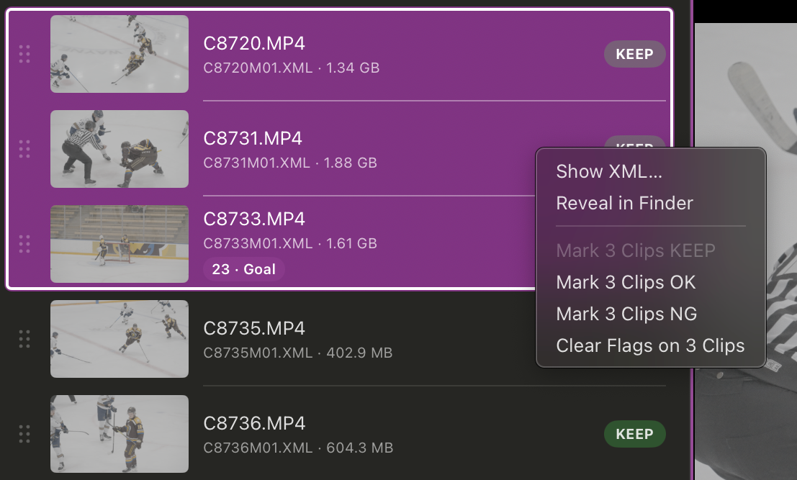
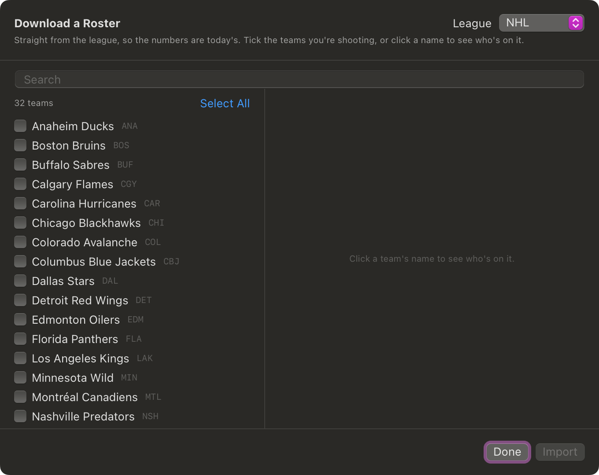
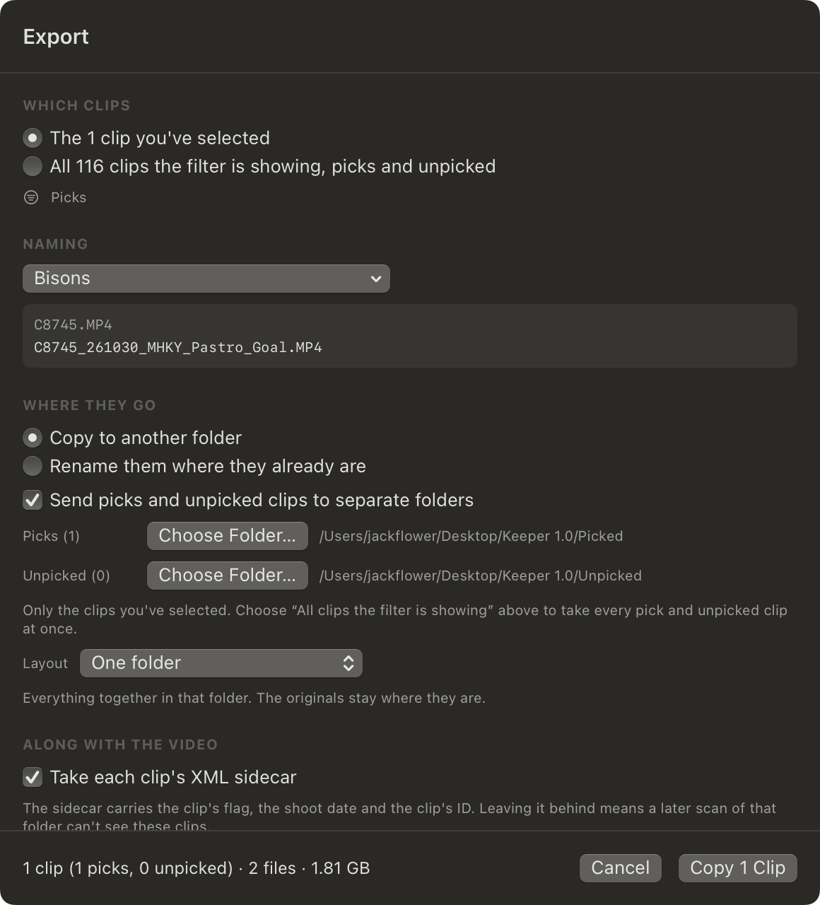

# Keeper

**Do your first edit at the game.** Flag good clips on the camera as you shoot. Keeper reads those flags off the card, lets you tag who's in each clip and what happened, and copies them out named and sorted.

Built by [JFlowerMedia](https://jflowermedia.com/) · [Download](../../releases) · macOS 13 or later

> **Alpha, version 1.0.0.** Tested with one camera on one Mac. It never writes to your cards, but keep a second copy of anything that matters. Bug reports welcome in [Issues](../../issues).


## How it works

1. **Flag clips in camera.** KEEP for the best, OK for the rest worth keeping.
2. **Open the card in Keeper.** It starts on your picks: every KEEP and OK clip.
3. **Tag each clip** with a player and what happened.
4. **Export.** Clips are copied out renamed from their tags, e.g. `C7531_261003_WHKY_Marchetti_Goal.MP4`.
5. **Check Copied** confirms every clip made it before you format the card.

## Features

- **Reads camera flags** (KEEP, OK, NG) from the XML sidecars on a card, drive or folder.
- **Previews clips** with keyboard playback, shuttle and full screen.
- **Tags clips** to players, subjects (mascot, crowd, anthem) and categories (Goal, Save, or your own). Several tags per clip.
- **Rosters** by CSV import, NHL download, or typed in.
- **Keyboard tagging**: clip, shirt number, category, done, with no mouse.
- **Filters** by team, player, position and category.
- **Renames** to your own filename presets, one per client.
- **Exports** to one folder, a folder per player or per category, or splits picks and unpicked into two folders.
- **Checks copies** against the card by the camera's clip ID, so renamed copies still match.


## Copy safety

- Nothing on a camera card is ever written, renamed or deleted. Flags you change are written to the copy only.
- Free space is checked before copying, and every copy is size-checked after.
- Existing files with the same name and size are skipped.
- Tags follow the clip's camera ID, so they survive renaming and copying.
- The Mac stays awake during a copy (idle sleep only; closing the lid still sleeps it).
- Tags are backed up automatically, ten versions deep.
- ⌘Z undoes flag and tag changes, forty steps deep.

## Which cameras

Built and tested on a **Sony A7S III**. On a Sony, assign **Clip Flag** KEEP (and OK, if you want it) to custom buttons under **Custom Key Setting**, then press while recording or playing back. Press again to remove it. See [Sony's Clip Flag guide](https://helpguide.sony.net/ilc/2210/v1/en/contents/TP1001690663.html); the FX3 needs firmware 6.00 or later.

The flag lives in the XML file beside each clip, so keep those files when you offload.

Other cameras: choose **Other…** in the **Camera** menu and type the word your camera writes. **Show XML…** on a clip's right-click menu shows what's there.

## Install

Download `Keeper.zip` from [Releases](../../releases), unzip, and drag **Keeper.app** to Applications.

Keeper isn't notarized by Apple, so macOS blocks the first launch:

1. Open Keeper and click **Done** on the warning.
2. Go to **System Settings → Privacy & Security** and click **Open Anyway** beside Keeper.
3. Open Keeper again and click **Open**.

Or run `xattr -dr com.apple.quarantine /Applications/Keeper.app` once.

**Build from source** (needs Xcode's command line tools):

```
git clone https://github.com/jflowermedia/keeper.git
cd keeper
./build_app.sh --install
```

See [DEVELOPING.md](DEVELOPING.md) for more.

---

# Guide

**Help → Welcome & Tutorial** walks through the basics. This is the reference.

## Shortcuts

| | |
|---|---|
| ↑ ↓ | Previous, next clip |
| Space or 2 | Play, pause |
| 1, 3 | Shuttle back, forward (press again for 2x, 4x, 8x) |
| ⌘F | Full screen (Escape to exit) |
| ⌘Return | Toggle KEEP on the previewed clip |
| O | Toggle OK on the previewed clip |
| ⇧⌘Return | Mark selection KEEP |
| ⌥⌘Return | Clear flags on selection |
| ⌘Z, ⇧⌘Z | Undo, redo |
| ⌘O | Choose folder |
| ⌘R | Rescan |
| ⌘E | Tagging panel |
| ⇧⌘T | Keyboard tagging |
| ⌘I | Import roster CSV |
| ⇧⌘R | Edit rosters |
| ⌘S | Export |
| ⇧⌘V | Check copied |
| ⌘D | Debug log |
| / | Clear tags on selected clips |
| § | Subjects pill, at the bench |
| ⌘, | Change any shortcut |

## Clips and flags

**Choose Folder…** scans a card, drive or folder. The tabs show:

- **Picks**: KEEP and OK clips
- **Unpicked**: NG and unflagged clips
- **All**

Badges show each clip's flag: **KEEP** green, **OK** yellow, **NG** red, **—** none. An orange outline means you changed it.

To change a flag:

- Click the badge to toggle KEEP.
- ⌘Return (KEEP) or O (OK) on the previewed clip. It then moves to the next clip; turn that off in **Mark → Move On After Marking**.
- Right-click for KEEP, OK, NG, Clear or Revert. Right-clicking inside a selection changes the whole selection.
- The **Mark** menu changes the selection.



## Rosters

Import a CSV with ⌘I. Only `number` and `name` are required:

```csv
league,team,code,number,name,position
MJHL,Virden Oil Capitals,VIR,27,Liam Goertzen,Forward
```

- `code` is the short team name used in filenames.
- `league` groups teams in the menus.
- Without a `team` column, the filename is the team name.

**File → Download a Roster…** imports NHL teams. Importing a team you already have shows the changes and lets you **Merge**, **Replace** or **Skip**.



**⇧⌘R** edits rosters. Player numbers must be unique within a team, and team names must be unique. Removed players keep their tags, marked **Not on roster**.

**Subjects** are things that aren't players: mascot, crowd, anthem. They're on their own pill after the teams.

## Tagging

**⌘E** opens the panel. Click a player, then a category.

- **Both teams** puts two rosters from the same league in play. ← → switch between them.
- Categories are grouped in sections. **+** adds one; right-click to move or remove.
- **+** by the categories adds a one-off tag. One-offs collect under **Recent**.
- **Move On After Tagging** (View menu) goes to the next clip after each tag.

### Keyboard tagging

**⇧⌘T** turns it on.

```
↓ ↓        pick the clip
Return     on to the roster
17         type the shirt number
Return     on to the categories
G          jump to Goal (or type its number)
Return     tag it and move to the next clip
```

- **⇧Return** tags and stays on the clip, for a second player.
- **Tab** / **⇧Tab** move between clips, roster and categories.
- **Escape** goes back a step.
- **O** marks OK at the clip step only. At the categories it jumps to a category.

## Exporting

**⌘S** opens the export sheet:

- **Which clips**: the selection, or everything shown
- **Naming**: a filename preset, or the camera's names
- **Where**: copy to a folder, or rename in place (not allowed on a card)
- **Layout**: one folder, per category, or per player
- **Split**: picks to one folder, unpicked to another
- **Sidecar**: whether the XML goes too (needed to carry flag changes)



**Edit Presets…** builds filename presets from parts: original name, shoot date, team code, surname, category. The default gives `C7531_261003_YWP_Marchetti_Goal.MP4`.


## Settings

| Setting | Where | Default |
|---|---|---|
| Camera | Toolbar | Sony |
| Move On After Marking | Mark menu | On |
| Move On After Tagging | View menu | Off |
| Warn Before Clearing Tags | View menu | On |
| Hold for Subjects Only | View menu | Off |
| Include XML Sidecars | View menu | On |
| Keep the Mac Awake While Transferring | View menu | On |
| Check for Updates Automatically | Help menu | On |

## Troubleshooting

- **No clips flagged?** Right-click a clip → **Show XML…** to see what the camera writes, then set **Camera → Other…** to that word.
- **Before formatting a card**, run **Check Copied** (⇧⌘V) with every folder you copied to.
- **Debug log** (⌘D) shows how each clip was read and every copy result.
- **Undo a roster edit**: **File → Restore Tags** rolls back to a backup.
- Your library is at `~/Library/Application Support/Keeper/library.json`.

## Updates

Keeper checks GitHub once a day and shows a notice when a new version is out. Nothing downloads automatically. Turn it off under **Help → Check for Updates Automatically**. The only other network use is downloading a roster.

## Known gaps

- Proxy files in `SUB` folders aren't handled.
- Clips without an XML sidecar aren't listed.

## Credits

Built by **JFlowerMedia** · [jflowermedia.com](https://jflowermedia.com/) · [@jflowermedia](https://www.instagram.com/jflowermedia/)

## License

MIT, see [LICENSE](LICENSE).

## Disclaimer

Keeper is alpha software, provided as is, without warranty. It is built to be read-only on your cards and checks every copy, but no software is bug-free. Confirm your clips copied and open correctly before formatting a card, and keep a second copy of work that matters. No liability is accepted for lost or damaged footage.
