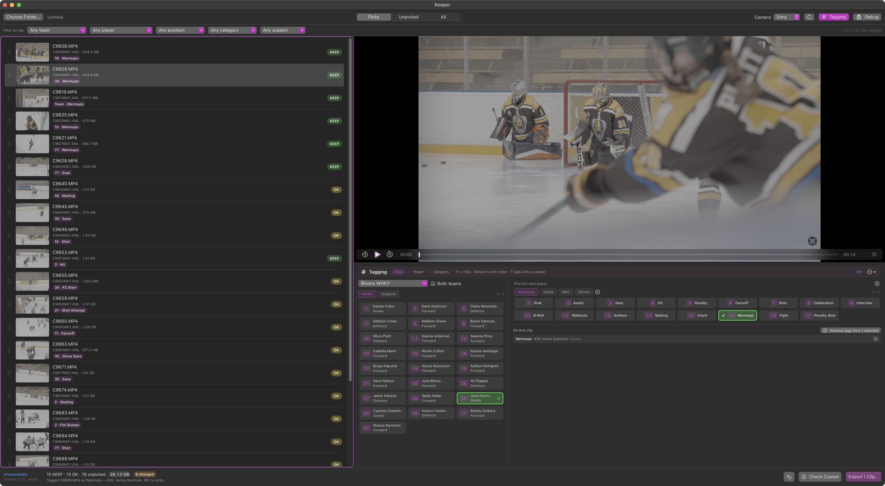

# Keeper

**Do your first edit at the game.** Flag good clips on the camera as you shoot. Keeper reads those flags off the card, lets you tag who's in each clip and what happened, and copies them out named and sorted.

Built by [JFlowerMedia](https://jflowermedia.com/) · [Download](../../releases) · macOS 13 or later

> **Alpha, version 1.4.0.** Tested with one camera, a Sony A7S III, on one Mac. It never writes to your cards, but keep a second copy of anything that matters. Bug reports welcome in [Issues](../../issues).



Flag clips as you shoot, then open the card: Keeper starts you on your picks, tags them against a roster, and copies them out renamed, e.g. `C7531_261003_WHKY_Marchetti_Goal.MP4`. **[Read the guide](GUIDE.md)**: six short steps, from setting up the camera to formatting the card.

## Copy safety

- Nothing on a camera card is ever written, renamed or deleted. Flags you change are written to the copy only.
- Free space is checked before copying, and every copy is size-checked after. Files already there with the same name and size are skipped.
- Tags follow the clip's camera ID, so they survive renaming and copying.
- The Mac stays awake during a copy (idle sleep only; closing the lid still sleeps it).
- Tags are backed up automatically, ten versions deep, and ⌘Z undoes flag and tag changes, forty steps deep.

## Install

Download `Keeper.zip` from [Releases](../../releases), unzip, and drag **Keeper.app** to Applications.

Keeper isn't notarized by Apple, so macOS blocks the first launch:

1. Open Keeper and click **Done** on the warning.
2. Go to **System Settings → Privacy & Security** and click **Open Anyway** beside Keeper.
3. Open Keeper again and click **Open**.

Or run `xattr -dr com.apple.quarantine /Applications/Keeper.app` once.

**Build from source** (needs Xcode's command line tools):

```
git clone https://github.com/jflowermedia/keeper.git
cd keeper
./build_app.sh --install
```

See [DEVELOPING.md](DEVELOPING.md) for more.

## Guide

**[Read the guide](GUIDE.md)**

1. [Set up the camera](GUIDE.md#1-set-up-the-camera)
2. [Get your roster](GUIDE.md#2-get-your-roster)
3. [Open the card](GUIDE.md#3-open-the-card)
4. [Tag](GUIDE.md#4-tag)
5. [Export](GUIDE.md#5-export)
6. [Check, then format](GUIDE.md#6-check-then-format)

[Shortcuts, settings and everything else](GUIDE.md#reference) are on the same page.

## Credits

Built by **JFlowerMedia** · [jflowermedia.com](https://jflowermedia.com/) · [@jflowermedia](https://www.instagram.com/jflowermedia/)

Themes use the [Catppuccin](https://github.com/catppuccin/catppuccin) palette, MIT.

## License

MIT, see [LICENSE](LICENSE).

## Disclaimer

Keeper is alpha software, provided as is, without warranty. It is built to be read-only on your cards and checks every copy, but no software is bug-free. Confirm your clips copied and open correctly before formatting a card, and keep a second copy of work that matters. No liability is accepted for lost or damaged footage.
